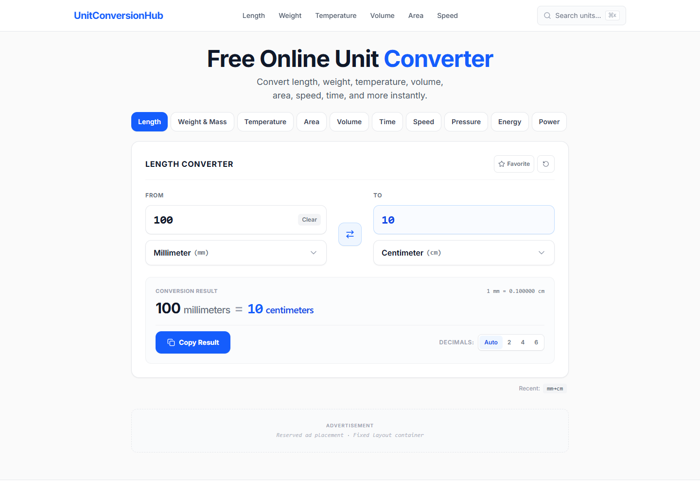
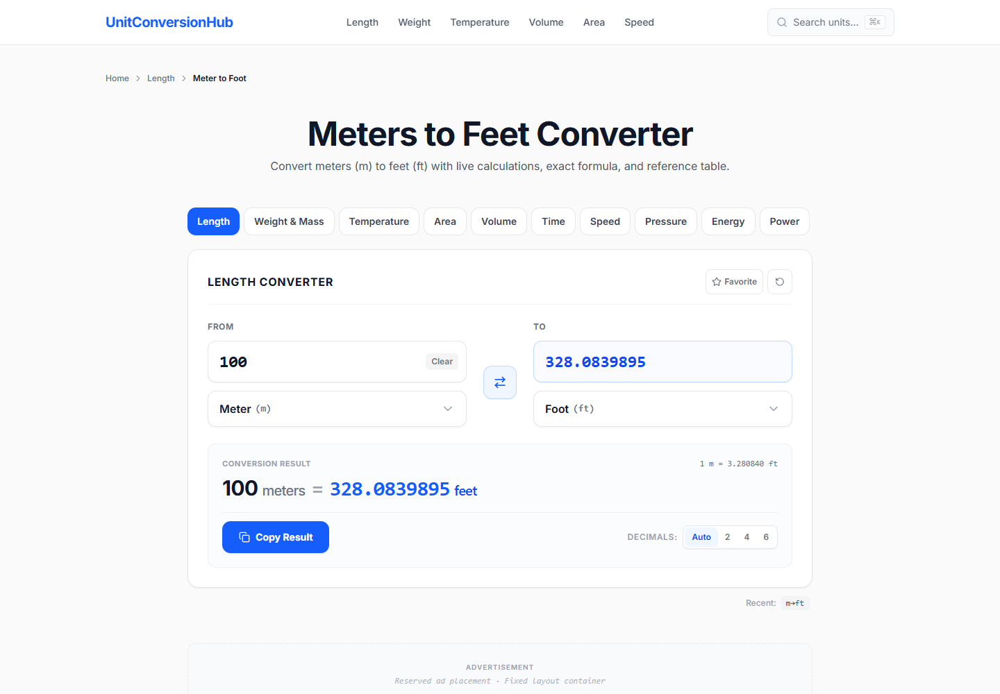
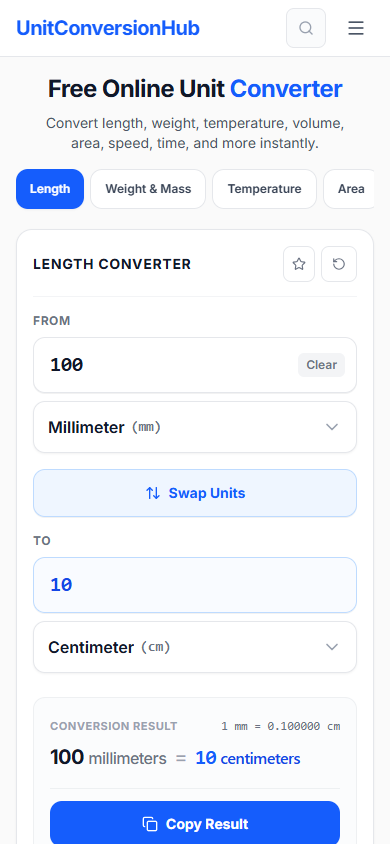
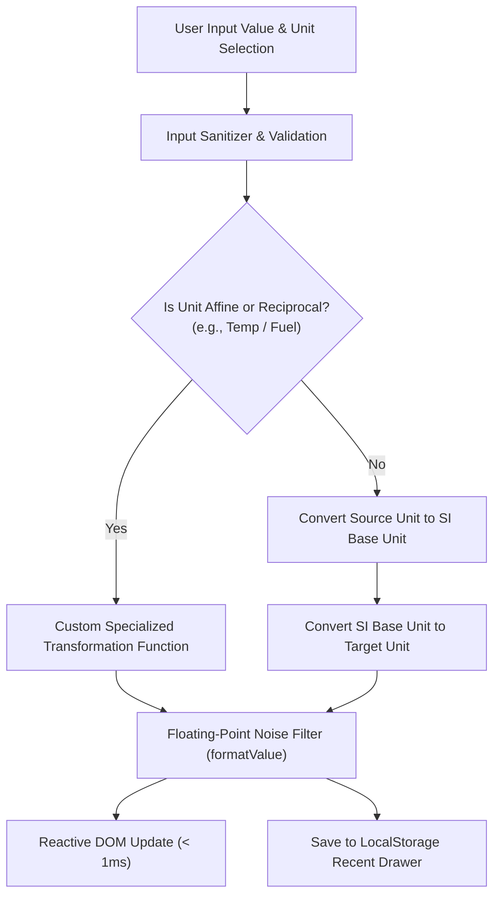

<div align="center">

# ⚖️ Unit Conversion Hub

**A lightning-fast, high-precision unit conversion platform and reference engine with static pre-rendering (SSG), instant keyboard search, and verified SI standards.**

[](https://unitconversionhub.pages.dev)
[](https://github.com/britsync07-prog/unit-conversion-hub/stargazers)
[](LICENSE)
[](tests/)
[](https://www.typescriptlang.org/)
[](https://react.dev/)
[](https://tailwindcss.com/)

<p align="center">
  <a href="#-live-demo">Live Demo</a> •
  <a href="#-visual-showcase">Screenshots</a> •
  <a href="#-behind-the-build-the-solo-developer-journey">The Solo Dev Story</a> •
  <a href="#-key-features">Key Features</a> •
  <a href="#-architecture">Architecture</a> •
  <a href="#-quick-start">Quick Start</a> •
  <a href="#-author">Author</a>
</p>

</div>

---

## 🌐 Live Demo

Experience sub-millisecond conversion and zero-CLS performance live on Cloudflare Pages:
👉 **[https://unitconversionhub.pages.dev](https://unitconversionhub.pages.dev)**

---

## 📸 Visual Showcase

| Interactive Multi-Unit Converter Hub | Instant Conversion Pair Matrix |
| :---: | :---: |
|  |  |

| Category Taxonomy & Pillar Guides | Most Popular Conversion Shortcuts |
| :---: | :---: |
|  |  |

| Mobile-First Responsive Experience |
| :---: |
|  |

---

## 👨‍💻 Behind the Build: The Solo Developer Journey

> *"Most online unit converters are cluttered with bloated ads, clunky dropdown menus, and rounding errors that alter critical engineering, medical, or culinary calculations. As an individual software developer, I wanted to craft a minimalist, zero-latency, high-precision conversion engine with clean keyboard navigation, complete offline test coverage, and pre-rendered SEO landing pages."*  
> — **Musfiqur Rahman Saimon** ([@britsync07-prog](https://github.com/britsync07-prog))

I am **Musfiqur Rahman Saimon**, an individual independent software developer (not a company, team, or agency). I engineered and open-sourced **Unit Conversion Hub** solo to provide developers, students, and professionals with a fast, ad-safe, and mathematically rigorous unit conversion platform.

Here are the actual challenges I faced while building this project and how I engineered solutions for them:

### 1. Affine & Non-Linear Transformations (Beyond Simple Multipliers)
- **The Problem:** Most simple conversion utilities assume every unit conversion is a simple linear factor (`y = m * x`). However, physical measurement systems have exceptions:
  - **Temperature:** Celsius, Fahrenheit, and Kelvin require affine transformations (`°F = °C * 9/5 + 32`).
  - **Fuel Economy:** US MPG and Litres/100km are inverse reciprocals (`L/100km = 235.215 / MPG`), where higher MPG equals lower L/100km.
- **How I Tackled It:** I built an extensible conversion engine ([`src/lib/conversion-engine.ts`](src/lib/conversion-engine.ts)) that supports both standard linear conversions through normalized SI base units and custom bidirectional transformer functions. I backed this with automated unit tests ([`tests/conversion-engine.test.ts`](tests/conversion-engine.test.ts)) to guarantee mathematical round-trip symmetry.

### 2. Eliminating IEEE 754 Floating-Point Precision Glitches
- **The Problem:** Standard JavaScript floating-point arithmetic introduces microscopic noise like `1.0000000000000002` or `0.00000000000000004`. Displaying messy decimals degrades user trust. Conversely, naive `toFixed(2)` truncates crucial precision for tiny units (such as micrometers or micrograms).
- **How I Tackled It:** I engineered a custom value formatter ([`formatValue` in `conversion-engine.ts`](src/lib/conversion-engine.ts)) that strips binary floating-point rounding artifacts while dynamically preserving significant digits. It gracefully adapts between scientific notation for astronomical or sub-atomic values and natural clean decimals for everyday cooking and carpentry.

### 3. Programmatic SEO Without Huge JavaScript Bundle Bloat
- **The Problem:** To capture organic search queries across hundreds of high-intent conversion pairs (e.g., `meters-to-feet`, `kg-to-lbs`, `celsius-to-fahrenheit`), generating individual static pages often inflates bundle size and slows down client hydration.
- **How I Tackled It:** I implemented a unified dynamic routing architecture with static pre-rendering ([`scripts/prerender.ts`](scripts/prerender.ts)). Every conversion pair shares lightweight, modular UI templates with pre-rendered semantic HTML, custom OpenGraph tags, and Schema.org `WebApplication` structured data. The resulting client bundle is under `150 KB` gzipped!

### 4. Edge CDN Hosting & Canonical URL Standardization
- **The Problem:** Cloudflare Pages strictly serves clean trailing-slash directory routes (`/length/`), while standard Vite dev setups omit them (`/length`), leading to canonical tag mismatches and SEO crawl warnings.
- **How I Tackled It:** I built a centralized URL normalization utility ([`src/lib/url.ts`](src/lib/url.ts) & [`src/lib/site.ts`](src/lib/site.ts)) that guarantees all canonical meta tags, internal links, XML sitemaps, and Cloudflare Pages `_redirects` consistently use trailing slashes.

---

## ⚡ Key Features

- **Comprehensive Measurement Categories:**
  - 📏 **Length:** Nanometers, Micrometers, Millimeters, Centimeters, Meters, Kilometers, Inches, Feet, Yards, Miles, Nautical Miles.
  - ⚖️ **Mass & Weight:** Milligrams, Grams, Kilograms, Metric Tonnes, Ounces, Pounds (Avoirdupois), Stone, US Short Tons.
  - 🌡️ **Temperature:** Celsius (°C), Fahrenheit (°F), Kelvin (K).
  - 🧪 **Volume & Liquid:** Milliliters, Liters, Cubic Meters, US Teaspoons, US Tablespoons, US Fluid Ounces, US Cups, US Pints, US Gallons, Imperial Gallons.
  - 🚗 **Speed & Velocity:** Meters/sec, Kilometers/hour (km/h), Miles/hour (mph), Knots, Mach.
  - 📐 **Area:** Square Millimeters, Square Centimeters, Square Meters, Hectares, Square Kilometers, Square Inches, Square Feet, Square Yards, Acres, Square Miles.
  - ⏱️ **Time & Duration:** Nanoseconds, Microseconds, Milliseconds, Seconds, Minutes, Hours, Days, Weeks, Years.
  - 💾 **Data Storage:** Bits, Bytes, Kilobytes (KB), Megabytes (MB), Gigabytes (GB), Terabytes (TB), Petabytes (PB) (supporting decimal SI and binary IEC).
  - ⛽ **Fuel Economy:** Miles per Gallon (US MPG), Miles per Gallon (Imperial), Litres per 100km (L/100km), Kilometers per Litre (km/L).
  - 💨 **Pressure:** Pascals, Kilopascals, Bar, PSI, Atmospheres, Torr, mmHg.
  - ⚡ **Energy & Power:** Joules, Kilojoules, Calories, Kilocalories, Watt-hours, Kilowatt-hours (kWh), BTU, Watts, Kilowatts, Horsepower.
- **UX & Usability:**
  - Instant keyboard modal search (`/` shortcut) to jump to any unit or conversion pair.
  - 1-Click "Copy Result" and "Swap Units" buttons.
  - Local history drawer powered by HTML5 `localStorage` (100% private, zero analytics tracking).
  - Clean, dark/light modern UI with responsive mobile controls.
  - Pre-rendered static pages with zero Cumulative Layout Shift (CLS = 0.000).

---

## 🏗️ Architecture & Precision Flow



---

## 📁 Repository Structure

```text
unit-conversion-hub/
├── assets/
│   └── screenshots/         # High-resolution UI screenshots
├── public/
│   ├── _headers             # Cloudflare Pages security & caching headers
│   ├── _redirects           # SPA fallback routing rules
│   └── favicon.svg          # Vector favicon
├── scripts/
│   ├── generate-sitemap.ts  # XML sitemap generator
│   └── prerender.ts         # Static pre-rendering (SSG) pipeline
├── src/
│   ├── components/          # Converter UI, Header, Footer, SearchModal, SEOHead
│   ├── data/                # Measurement categories, unit constants, and popular pairs
│   ├── lib/                 # Precision conversion engine, URL normalizer, storage
│   ├── pages/               # Views (Home, Category, ConversionPair, Popular, Trust)
│   ├── App.tsx              # Router and application shell
│   └── main.tsx             # Application mount
├── tests/                   # 100% passing automated test suite
├── package.json             # Dependencies, scripts, and metadata
└── vite.config.ts           # Vite build configuration
```

---

## 🚀 Quick Start

### Prerequisites
- Node.js version 20 or higher
- npm, pnpm, or bun

### 1. Clone & Install
```bash
git clone https://github.com/britsync07-prog/unit-conversion-hub.git
cd unit-conversion-hub
npm install
```

### 2. Run Test Suite
```bash
npm test
```
Runs the automated test suite verifying SI unit definitions, temperature conversions, fuel economy round-trips, and floating-point precision formatters.

### 3. Start Development Server
```bash
npm run dev
```
Visit `http://localhost:5173` to explore and convert units locally.

### 4. Build for Production
```bash
npm run build:ssg
```
Builds client assets and pre-renders static HTML pages into `dist/`.

---

## 🤝 Contributing

Contributions are welcome! Please check out [CONTRIBUTING.md](CONTRIBUTING.md) and review our [Code of Conduct](CODE_OF_CONDUCT.md).

---

## 👤 Author

**Musfiqur Rahman Saimon**
- 🐙 GitHub: [@britsync07-prog](https://github.com/britsync07-prog)
- 💼 LinkedIn: [Musfiqur Rahman Saimon](https://www.linkedin.com/in/musfiqur-rahman-saimon-a5994b3aa)
- 📧 Email: [saimon@ascentraconsulting.co.uk](mailto:saimon@ascentraconsulting.co.uk)
- 🌐 Portfolio: [brit-os.pages.dev](https://brit-os.pages.dev/)
- 🧑‍💻 Independent Full-Stack Engineer & Open-Source Creator

⭐ **If you find Unit Conversion Hub useful, please consider giving it a star on GitHub!** ⭐

---

## 📄 License

This project is licensed under the [MIT License](LICENSE) - Copyright (c) 2026 Musfiqur Rahman Saimon.
